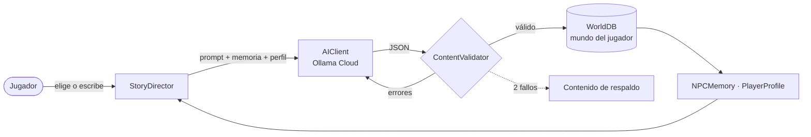

<div align="center">

# 🌌 Dreamer's Space World

**Todos empiezan igual. Nadie termina en el mismo universo.**

Juego 3D de mundo abierto sobre multiversos y viajes en el tiempo, donde una IA genera,<br>
a partir de tus decisiones, un mundo **único y persistente** para cada jugador.

[](https://github.com/ahiram1701/dreamers-space-world/actions/workflows/ci.yml)
[](https://github.com/ahiram1701/dreamers-space-world/releases)
[](https://godotengine.org)
[](https://ollama.com)
[](LICENSE)

</div>

---

## ✨ La idea

Todos los jugadores descargan el mismo juego y empiezan con la misma vida: una **persona común** en un pueblo costero del presente. Pero cada conversación, cada decisión y cada palabra que escribes queda registrada. A partir de ahí, la IA **crea contenido nuevo y permanente**: personas, lugares, objetos y, más adelante, épocas y universos enteros.

Tras unas horas de juego, tu copia del juego ya no se parece a la de nadie más.

## 🧠 Principio de diseño: *la IA diseña, el motor construye*

Un modelo de lenguaje no puede generar en tiempo real modelos 3D ni código fiable, pero sí puede **diseñar contenido como datos**:

1. El juego trae una **biblioteca de piezas** ([`data/archetypes.json`](data/archetypes.json)): biomas, tipos de cuerpo, emociones, efectos de objetos…
2. La IA devuelve **definiciones JSON** que combinan esas piezas, limitadas por un *JSON schema*.
3. Un **validador** comprueba cada definición y, si algo falla, se lo devuelve a la IA para que se corrija sola.
4. El motor la construye y la guarda en el **mundo persistente del jugador**.



Si la IA no está disponible, el juego usa contenido de respaldo y **nunca se queda bloqueado**.

## 🎮 Estado actual

| | Funcionalidad |
|---|---|
| ✅ | Cliente de Ollama Cloud con salida estructurada, reintentos y modo *mock* sin red |
| ✅ | Validación de entidades (PNJs, lugares, objetos, turnos de diálogo) con autocorrección |
| ✅ | Mundo persistente por jugador, con el origen de cada entidad registrado |
| ✅ | **Acto 0 — Bahía de las Horas**: pueblo 3D, jugador en tercera persona, 3 vecinos |
| ✅ | Conversaciones generadas por IA con opciones **o texto libre** |
| ✅ | Memoria de PNJs (hechos, relación) y perfil del jugador inferido de sus decisiones |
| ✅ | **El Despertar** (ciencia ficción): la IA elige el origen científico de tu Ancla según cómo jugaste, con canon permanente y una decisión que ramifica la historia |
| ✅ | Árbol de líneas temporales, energía, inestabilidad y saltos con el Ancla (<kbd>T</kbd>) |
| ✅ | **Mundos generados**: cada salto a lo desconocido crea un lugar 3D nuevo (terreno, cielo, gravedad, balizas) con sus habitantes |
| ✅ | **Mundos variados**: ciudades y pueblos con el estilo de su época, estaciones espaciales entre estrellas, ruinas, vegetación, cristales, lava, océanos y zonas de anomalía |
| ✅ | **Misiones generadas** en cada mundo, ancladas a lugares, personas y objetos reales |
| ✅ | **Hilo principal**: reúne 5 fragmentos de coordenadas y sigue la transmisión hasta su origen |
| ✅ | **Final** escrito para tu partida, con 3 desenlaces, epílogo y créditos con el resumen de tu multiverso |
| ✅ | Inventario y objetos usables, inestabilidad con fallos visuales, desanclaje y recuperación |
| ✅ | Siguiente destino pregenerado en segundo plano, túnel de salto y sonido ambiental procedural |
| ✅ | **Lo que se dice, pasa**: los PNJs dan, prestan, reciben, acompañan, curan, encargan favores y revelan lugares de verdad |
| ✅ | **Hacer algo** (<kbd>F</kbd>): describe cualquier acción y la IA narra qué ocurre en el mundo |
| ✅ | Ciclo de día y noche, rutinas de los vecinos, diario y encargos |
| ✅ | Modelos 3D CC0 animados, mar con olas, hierba con viento e iluminación con SSAO, glow y niebla |
| ✅ | Menú de pausa, ajustes (IA, ratón, volumen, calidad gráfica, personaje) y gestión de partidas |

## 🚀 Jugar

### Descargar
Descarga la última versión para **Windows** o **Linux** desde [Releases](https://github.com/ahiram1701/dreamers-space-world/releases), descomprímela y ejecútala.

### Actualizaciones automáticas
Desde la **v0.2.0**, el juego comprueba al arrancar si hay una versión estable nueva en GitHub Releases. Si la hay, el menú muestra **Actualizar**: el juego descarga la versión nueva, verifica su SHA-256, se reemplaza y se reinicia. **Tus mundos y ajustes se conservan**, porque viven en la carpeta de usuario y no junto al ejecutable. Puedes desactivarlo en *Ajustes → Buscar actualizaciones*.

> Si instalas el juego en una carpeta protegida (p. ej. `Program Files`), *Actualizar* abre la página de descarga. Las versiones `-alpha`/`-beta` nunca se ofrecen como actualización.

### Desde el código
1. Instala [Godot 4.7.2](https://godotengine.org/download) (versión estándar), por ejemplo con `winget install --id GodotEngine.GodotEngine --version 4.7.2 -e`.
2. Clona el repositorio y abre `project.godot`.
3. Pulsa <kbd>F5</kbd>.

### Configurar la IA
1. Crea una API key en [ollama.com](https://ollama.com) (Ollama Cloud).
2. En el menú, abre **Ajustes de IA**, pega la key y pulsa *Guardar ajustes*.
3. Si no tienes key, marca **Modo mock** para jugar con respuestas predefinidas.

> 🔒 La key se guarda **cifrada y ligada a tu equipo** en la carpeta de usuario de Godot (`user://`). Nunca entra en el repositorio.

### Controles
| Acción | Tecla |
|---|---|
| Moverse / correr | <kbd>W</kbd><kbd>A</kbd><kbd>S</kbd><kbd>D</kbd> / <kbd>Shift</kbd> |
| Saltar | <kbd>Espacio</kbd> |
| Cámara | Ratón |
| Hablar / recoger | <kbd>E</kbd> |
| Hacer algo (acción libre) | <kbd>F</kbd> |
| Ancla (saltar) | <kbd>T</kbd> |
| Inventario, encargos y diario | <kbd>I</kbd> |
| Pausa | <kbd>Esc</kbd> |

## 🏗️ Arquitectura

| Autoload | Responsabilidad |
|---|---|
| [`Settings`](autoload/Settings.gd) | API key cifrada, modelo, idioma y modo mock |
| [`AIClient`](autoload/AIClient.gd) | `POST /api/chat` a Ollama Cloud con *JSON schema* y reintentos |
| [`ContentValidator`](autoload/ContentValidator.gd) | Única fuente de verdad del formato de cada entidad: valida y genera el schema |
| [`WorldDB`](autoload/WorldDB.gd) | El mundo único de cada jugador (`user://worlds/<id>/`) |
| [`ContentGenerator`](autoload/ContentGenerator.gd) | IA → validar → autocorregir → respaldo → guardar |
| [`StoryDirector`](autoload/StoryDirector.gd) | Conversaciones turno a turno con los PNJs |
| [`NPCMemory`](autoload/NPCMemory.gd) | Lo que cada PNJ recuerda del jugador |
| [`PlayerProfile`](autoload/PlayerProfile.gd) | Carácter del jugador inferido de cómo juega |
| [`Updater`](autoload/Updater.gd) | Busca versiones estables en GitHub Releases y se actualiza con un clic |
| [`GameState`](autoload/GameState.gd) | Salud, energía, inestabilidad, fragmentos, compañero y final |
| [`TimelineManager`](autoload/TimelineManager.gd) | Árbol de líneas temporales (muchos mundos: nada se reescribe) |
| [`Travel`](autoload/Travel.gd) | Saltos, generación de mundos y pregeneración en segundo plano |
| [`Inventory`](autoload/Inventory.gd) / [`Quests`](autoload/Quests.gd) | Objetos usables, préstamos y misiones generadas |
| [`Actions`](autoload/Actions.gd) / [`Journal`](autoload/Journal.gd) | Hace real lo que la IA decide (dar, acompañar, curar…) y el diario |
| [`WorldClock`](autoload/WorldClock.gd) | Hora del mundo, día y noche |

```
assets/        Modelos 3D CC0 (ver assets/CREDITS.md)
autoload/      Sistemas globales (IA, mundo, memoria, narrativa)
data/          Reglas del multiverso, piezas, PNJs base y contenido de respaldo
scenes/        Menú principal, Acto 0, UI y herramientas de desarrollo
procgen/       Terreno, decoración y elección de modelos por arquetipo
scripts/       Jugador, PNJs (animación por código), entorno y día/noche
shaders/       Agua, suelo y hierba
tests/         Pruebas unitarias y smoke test
.github/       CI y publicación automática
```

## 🧪 Pruebas

```bash
godot --headless --import --path .
godot --headless --path . -s tests/test_validator.gd   # pruebas del validador
godot --headless --path . -s tests/test_semver.gd      # pruebas de versiones (actualizador)
godot --headless --path . -s tests/test_awakening_flow.gd  # El Despertar y los saltos
godot --headless --path . -s tests/test_full_game.gd   # partida completa: misiones, fragmentos y final
godot --headless --path . -s tests/test_actions.gd     # lo que los PNJs aceptan hacer pasa de verdad
bash tests/smoke.sh                                    # arranca las escenas y busca errores de script
```

La [CI](.github/workflows/ci.yml) ejecuta todo esto en cada push y en cada pull request.

## 📦 Publicar una versión

```bash
git tag v0.2.0
git push origin v0.2.0
```

El workflow de [release](.github/workflows/release.yml) pasa las pruebas, exporta las builds de Windows y Linux con Godot y publica una Release en GitHub. Los tags con sufijo (`-alpha`, `-beta`, `-rc`) se publican como *pre-release*.

## 📄 Licencia

© 2026 ahiram1701. **Todos los derechos reservados.** El código se publica solo para consulta; consulta [LICENSE](LICENSE).

Los modelos 3D de `assets/models/` son de [Quaternius](https://quaternius.com) con licencia CC0 (dominio público); ver [assets/CREDITS.md](assets/CREDITS.md).
